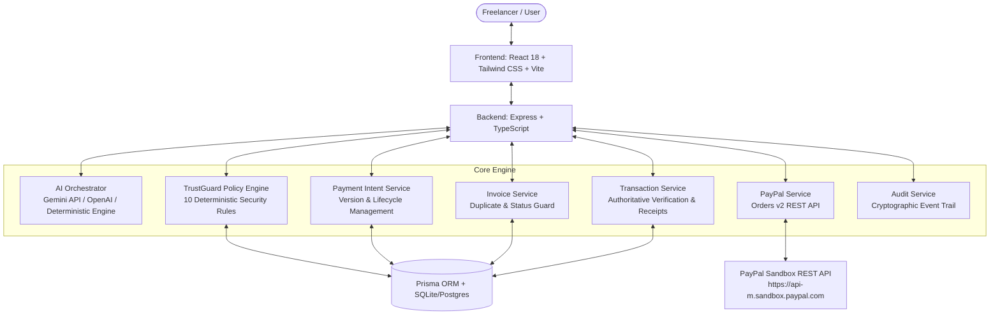

# PayPilot AI 🚀
### Intelligent PayPal Payment Copilot | PayPal AI Hackathon 2026

[](LICENSE)
[](https://www.typescriptlang.org/)
[](https://developer.paypal.com/)
[](https://vitest.dev/)

> **Tagline**: An AI payment copilot that turns invoices and natural-language requests into secure, user-approved, verifiable PayPal payments.

---

## 🌟 Hackathon Requirements & Compliance Matrix

| Requirement | Implementation Status | Evidence / Verification |
|---|---|---|
| **1. Meaningfully integrate PayPal developer platform** | **VERIFIED** | Real PayPal Orders v2 REST API (`/v2/checkout/orders`), OAuth 2.0 client credentials token handling, authoritative server-side capture (`/v2/checkout/orders/{id}/capture`), and buyer checkout coordination. |
| **2. Meaningfully incorporate AI tool or model** | **VERIFIED** | AI Orchestrator supporting Google Gemini API (`@google/generative-ai`), OpenAI API, and high-precision structured tool calling grounded in database records. |
| **3. Working prototype or proof of concept** | **VERIFIED** | Complete working full-stack React + Express + Prisma application running locally and verified by 17 automated end-to-end tests. |
| **4. Document features and functionality** | **VERIFIED** | Detailed feature documentation, interactive UI guide, and video recording walkthrough script included. |
| **5. Explain technologies and AI tools used** | **VERIFIED** | Complete tech stack breakdown, architecture diagram, and security threat model in `docs/architecture.md`. |
| **6. Public Git repository** | **VERIFIED** | Clean monorepo structure with `.gitignore`, zero committed secrets, and reproducible build scripts. |
| **7. Reproducible setup instructions** | **VERIFIED** | Zero-friction local run guide with seeded database and one-command launch. |
| **8. Open-source LICENSE at root** | **VERIFIED** | Permissive [MIT LICENSE](LICENSE) located at repository root. |
| **9. Functional demo / local run instructions** | **VERIFIED** | Verified local environment running with Node.js 24 and Express on port 4000 & Vite on port 5173. |
| **10. Public demo video (< 3 minutes)** | **READY** | Complete 2:40 script prepared in [docs/demo-script.md](docs/demo-script.md) covering the entire live workflow. |

---

## 🎯 The Problem & The Core Differentiator

### The Problem
Freelancers and SMBs repeatedly waste hours manually interpreting vendor invoices, double-checking whether an invoice was previously paid, copying amounts into payment tools, navigating checkout, and verifying receipts. Generic LLM chatbots may talk about payment steps, but cannot be trusted to safely prepare transactions without strict policy enforcement and authoritative financial proof.

### The Solution: PayPilot AI
PayPilot AI connects the entire invoice-to-payment workflow through three integrated capabilities:

### 1. Smart Invoice Guard
- Stores and tracks vendor invoices (e.g. AWS Hosting, Supabase, Figma).
- Validates invoice amounts, currencies, and due dates.
- Detects potential duplicates by comparing invoice identifiers, vendors, amounts, and billing periods.
- Prevents double payments before any checkout attempt.

### 2. TrustGuard Policy Engine (10 Deterministic Backend Rules)
Financial security is **never delegated to an LLM**. TrustGuard runs 10 deterministic rules on every payment proposal:
1. `USER_AUTHORIZATION`: Object-level ownership check.
2. `VALID_AMOUNT`: Positive amounts only, max $10,000 per transaction.
3. `SUPPORTED_CURRENCY`: Supported whitelist (`USD`, `EUR`, `GBP`, `CAD`, `AUD`).
4. `INTENT_EXPIRATION`: 15-minute validity window.
5. `INVOICE_NOT_PAID`: Rejects payments for settled invoices.
6. `INVOICE_NOT_CANCELLED`: Rejects voided invoices.
7. `INVOICE_AMOUNT_MATCH`: Authoritative comparison of intent vs invoice total.
8. `DUPLICATE_PAYMENT_DETECTION`: Velocity and duplicate transaction prevention.
9. `EXPLICIT_APPROVAL_EXISTS`: Requires signed server-side approval.
10. `APPROVAL_VERSION_INTEGRITY`: Approval is strictly bound to `(intentId, intentVersion)`. If amount or details are modified after approval, version increments (`v1 -> v2`) and previous approval is instantly revoked.

### 3. Proof of Payment & Authoritative Capture
- Server captures orders authoritatively using PayPal REST API Orders v2.
- Verifies that captured amount and currency match the approved database intent.
- Updates invoice status to `PAID` only upon authoritative confirmation.
- Generates verifiable receipts containing real PayPal Order IDs and Capture IDs.
- Records an immutable audit event trail.

---

## 🏗️ Architecture



---

## 💻 Tech Stack

- **Frontend**: React 18, TypeScript, Vite, Tailwind CSS, Lucide Icons, Canvas Confetti.
- **Backend**: Node.js, Express, TypeScript, Prisma ORM.
- **Payments**: PayPal Orders v2 REST API, OAuth 2.0 Access Token Handling.
- **AI Engine**: Google Gemini API (`@google/generative-ai`), OpenAI API, Grounded Deterministic Extractor.
- **Database**: SQLite (out-of-the-box local zero-config) / PostgreSQL support via Prisma.
- **Testing**: Vitest, Supertest (17 unit and API integration tests).

---

## ⚡ Quick Start & Installation

### Prerequisites
- Node.js 18+ (tested on Node.js 24)
- npm 9+

### 1. Clone & Install Dependencies
```bash
git clone https://github.com/your-username/paypilot-ai.git
cd "paypilot AI"
npm install
```

### 2. Configure Environment Variables
Copy `.env.example` to `.env`:
```bash
cp .env.example .env
```
*(Optional)* Add your PayPal Sandbox credentials from [PayPal Developer Dashboard](https://developer.paypal.com/dashboard/applications/sandbox):
```env
PAYPAL_CLIENT_ID=your_paypal_sandbox_client_id
PAYPAL_CLIENT_SECRET=your_paypal_sandbox_client_secret
PAYPAL_ENVIRONMENT=sandbox
```
*(Note: If left empty, PayPilot AI seamlessly runs in local Sandbox Test Mode with full state integrity and simulated sandbox credentials).*

### 3. Initialize & Seed Database
```bash
npx prisma db push --schema=prisma/schema.prisma
npm run prisma:seed --workspace=apps/api
```

### 4. Run the Full Application
```bash
npm run dev
```
- **Web UI**: [http://localhost:5173](http://localhost:5173)
- **API Server**: [http://localhost:4000](http://localhost:4000)

---

## 🧪 Running Automated Tests

Run the complete test suite (Unit tests + API integration tests):
```bash
npm test
```

Test coverage includes:
- ✅ TrustGuard Policy Engine (10 rules evaluated)
- ✅ Positive amount validation & single-tx limit enforcement ($10,000)
- ✅ Supported currency whitelist
- ✅ Unauthorized object-level access prevention
- ✅ Intent expiration enforcement
- ✅ Approval version integrity (tampering prevention)
- ✅ Natural language AI intent understanding & grounding
- ✅ Ambiguous request clarification
- ✅ Authoritative PayPal Orders v2 creation & capture
- ✅ Authoritative receipt generation
- ✅ Duplicate payment blocking on settled invoices

---

## 🎬 Live Demo Scenario (Turn-by-Turn)

1. Open [http://localhost:5173](http://localhost:5173).
2. Go to **AI Copilot** and click: `"Prepare my hosting payment for this month"`.
3. AI matches the unpaid **AWS Cloud Services** invoice (`$24.99 USD`).
4. **TrustGuard** evaluates all 10 policy checks: amount, currency, invoice status, duplicate check.
5. Review the **Payment Intent Card** and click **Explicitly Approve (v1)**.
6. Click **Proceed to PayPal Sandbox Checkout**.
7. In the PayPal checkout dialog, execute **PayPal Sandbox Instant Pay & Capture**.
8. View the **Authoritative Receipt** with verified PayPal Capture ID and Order ID.
9. Try asking: `"Pay AWS Cloud Services invoice again"` → **TrustGuard safely blocks duplicate payment!**

---

## 📄 License

This project is licensed under the [MIT License](LICENSE).
