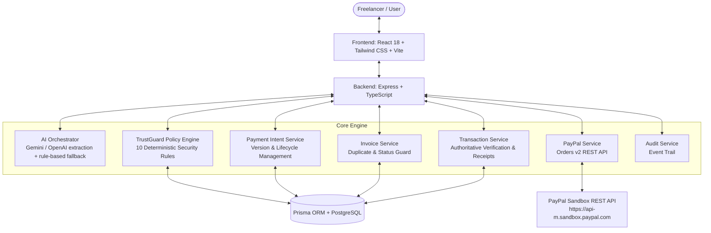

# PayPilot AI 🚀
### Intelligent PayPal Payment Copilot | PayPal AI Hackathon 2026

[](LICENSE)
[](https://www.typescriptlang.org/)
[](https://developer.paypal.com/)
[](https://vitest.dev/)

> **Tagline**: An AI payment copilot that turns invoices and natural-language requests into secure, user-approved, verifiable PayPal payments.

---

## 🌟 Hackathon Requirements & Honest Status

Statuses use: **VERIFIED** (executed with evidence), **IMPLEMENTED** (code complete, not yet executed end-to-end by the author), **TODO**.
Update this table with your own evidence (screenshots, capture IDs, test output) before submitting.

| Requirement | Status | Notes |
|---|---|---|
| PayPal Sandbox integration (Orders v2, OAuth, JS SDK buttons, server-side capture) | IMPLEMENTED | Fails closed without credentials. Run one real Sandbox checkout and record the capture ID as evidence. |
| Meaningful AI: tool-calling agent (Gemini / OpenAI) over server-scoped tools, with a rule-based fallback | IMPLEMENTED | The agent loop, tools, guards and prompt-injection defences are VERIFIED with a scripted model. Live Gemini/OpenAI calls need your key and are not yet verified. |
| Working prototype | IMPLEMENTED | React + Express + Prisma. |
| Documentation of features, tech and AI tools | VERIFIED | This README and `docs/`. |
| Public repo, root LICENSE (MIT) | VERIFIED | |
| Automated tests | VERIFIED | 131 tests passing: API + unit tests on real PostgreSQL, plus React component tests in jsdom. 3 real-Sandbox tests skip without credentials. PayPal is a test double or mocked network except in those. |
| Local run instructions | VERIFIED | Fresh Postgres + migrations + seed + production build were executed and smoke-tested over HTTP. |
| Hosted demo | IMPLEMENTED | `render.yaml` blueprint provided; not yet deployed by the author. |
| Public demo video < 3 min | TODO | Script in `docs/demo-script.md` |

## 🎯 The Problem & The Core Differentiator

### The Problem
Freelancers and SMBs repeatedly waste hours manually interpreting vendor invoices, double-checking whether an invoice was previously paid, copying amounts into payment tools, navigating checkout, and verifying receipts. Generic LLM chatbots may talk about payment steps, but cannot be trusted to safely prepare transactions without strict policy enforcement and authoritative financial proof.

### The Solution: PayPilot AI
PayPilot AI connects the entire invoice-to-payment workflow through three integrated capabilities:

### 1. Smart Invoice Guard
- Stores and tracks vendor invoices (e.g. AWS Hosting, Supabase, Figma).
- Validates invoice amounts, currencies, and due dates.
- Detects potential duplicates by comparing invoice identifiers, vendors, amounts, and billing periods.
- Prevents double payments before any checkout attempt.

### 2. TrustGuard Policy Engine (10 Deterministic Backend Rules)
Financial security is **never delegated to an LLM**. TrustGuard runs 10 deterministic rules on every payment proposal:
1. `USER_AUTHORIZATION`: Object-level ownership check.
2. `VALID_AMOUNT`: Positive amounts only, max $10,000 per transaction.
3. `SUPPORTED_CURRENCY`: Supported whitelist (`USD`, `EUR`, `GBP`, `CAD`, `AUD`).
4. `INTENT_EXPIRATION`: 15-minute validity window.
5. `INVOICE_NOT_PAID`: Rejects payments for settled invoices.
6. `INVOICE_NOT_CANCELLED`: Rejects voided invoices.
7. `INVOICE_AMOUNT_MATCH`: Authoritative comparison of intent vs invoice total.
8. `DUPLICATE_PAYMENT_DETECTION`: Velocity and duplicate transaction prevention.
9. `EXPLICIT_APPROVAL_EXISTS`: Requires signed server-side approval.
10. `APPROVAL_VERSION_INTEGRITY`: Approval is strictly bound to `(intentId, intentVersion)`. If amount or details are modified after approval, version increments (`v1 -> v2`) and previous approval is instantly revoked.

### 3. Proof of Payment & Authoritative Capture
- Server captures orders authoritatively using PayPal REST API Orders v2.
- Verifies that captured amount and currency match the approved database intent.
- Updates invoice status to `PAID` only upon authoritative confirmation.
- Generates verifiable receipts containing real PayPal Order IDs and Capture IDs.
- Records an append-only audit event trail.

---

## 🏗️ Architecture



---

## 💻 Tech Stack

- **Frontend**: React 18, TypeScript, Vite, Tailwind CSS, Lucide Icons, Canvas Confetti.
- **Backend**: Node.js, Express, TypeScript, Prisma ORM.
- **Payments**: PayPal Orders v2 REST API, OAuth 2.0 Access Token Handling.
- **AI Agent**: a provider-agnostic tool-calling loop over Google Gemini (`@google/generative-ai`) or OpenAI, with a rule-based fallback when no key is set or the provider fails. The model can only call server-scoped tools (`list_invoices`, `get_invoice_details`, `check_duplicate_invoice`, `get_payment_policy`, `prepare_payment_intent`, `request_payment_approval`, `get_transaction_history`, `get_spending_summary`). There is **no** approve, capture or pay tool, so no model output (including a prompt-injected one) can move money. Details below.
- **Database**: PostgreSQL via Prisma (Rust-free client + `@prisma/adapter-pg`). Money is stored as **integer minor units (cents)**, never floating point; a database CHECK constraint also rejects non-positive invoice/transaction amounts.
- **Auth**: scrypt-hashed passwords, signed JWT bearer tokens (8h), one-click demo identity for judges. Object-level authorization on every record.
- **Testing**: Vitest, Supertest (unit and API integration tests).

---

## ⚡ Quick Start & Installation

### Prerequisites
- Node.js 20+ (tested on Node.js 22)
- npm 9+
- PostgreSQL 14+ running locally (or any hosted Postgres), e.g. `docker run -d -p 5432:5432 -e POSTGRES_PASSWORD=password postgres:16`

### 1. Clone & Install Dependencies
```bash
git clone https://github.com/pramod190/paypilot-AI.git
cd paypilot-AI
npm install
```

### 2. Configure Environment Variables
Copy `.env.example` to `.env`:
```bash
cp .env.example .env
```
Add your PayPal **Sandbox** credentials from the [PayPal Developer Dashboard](https://developer.paypal.com/dashboard/applications/sandbox) (required for checkout):
```env
PAYPAL_CLIENT_ID=your_paypal_sandbox_client_id
PAYPAL_CLIENT_SECRET=your_paypal_sandbox_client_secret
PAYPAL_ENVIRONMENT=sandbox
```
*(Note: without credentials, checkout returns a clear 503 error. There is no simulated checkout mode. Test doubles exist only inside the automated test suite.)*

Add one LLM key for the AI Copilot (optional but recommended): `GEMINI_API_KEY` **or** `OPENAI_API_KEY`.

For webhooks, create a Sandbox webhook pointing to `/api/webhooks/paypal` and set `PAYPAL_WEBHOOK_ID`. Webhooks without a valid PayPal signature are rejected.

### 3. Create the Databases, Apply Migrations & Seed
```bash
createdb -h localhost -U postgres paypilot        # development database
createdb -h localhost -U postgres paypilot_test   # used only by `npm test` (it wipes and reseeds demo data)
npm run db:migrate                                # applies prisma/migrations to DATABASE_URL
npm run db:seed                                   # clearly-labelled demo invoices for the demo user
```
`npm install` also runs `prisma generate` automatically. The demo data is also created automatically on first boot if the demo account has no invoices.

### 4. Run the Full Application
```bash
npm run dev
```
- **Web UI**: [http://localhost:5173](http://localhost:5173)
- **API Server**: [http://localhost:4000](http://localhost:4000)

---

## 🤖 How the AI Agent Stays Safe

The model is treated as an untrusted advisor. Safety lives in ordinary server code, so it holds even if the model is jailbroken:

- **No dangerous tools exist.** The model can prepare a proposal and show an approval card; only the signed-in user can approve (bound to the exact intent version) and only a server-verified PayPal capture completes a payment.
- **The database wins over the model.** For invoice payments, amount, currency and recipient come from the invoice record; anything the model passes is ignored and reported back to it.
- **Every tool is user-scoped.** Another user's invoices are indistinguishable from "not found".
- **Untrusted text is quarantined.** Invoice descriptions reach the model only as a length-capped, control-character-stripped field named `untrustedDescription`; client "system" messages are never forwarded as instructions.
- **Arguments are validated** with Zod per tool; errors go back to the model, the loop is capped at 6 steps.
- **Claim guard.** If the model says a payment succeeded or was approved without having read verified records in that turn, the server replaces the sentence with a correction and audits it (`AI_CLAIM_BLOCKED`).
- **Policy still applies.** TrustGuard evaluates every proposal; new payees (payments with no invoice) are flagged on the approval card.

Also included: `POST /api/invoices/extract` turns pasted invoice text into an **unsaved** draft with duplicate evidence and injection warnings (works with or without an LLM), `GET /api/insights/*` for server-computed spending and outstanding figures, `GET /api/transactions` with text, amount, status and date filters, and `GET /api/intents` for the Payments screen.

## 🔒 Operations & Security Notes

Signed JWT bearer auth (no cookies, so no CSRF surface) with scrypt password hashing; rate limits on auth, AI and payment routes; helmet security headers with a PayPal-aware CSP (report-only until `CSP_ENFORCE=true`); request IDs on every response and one structured log line per request (bodies and tokens are never logged); recursive audit redaction; startup config validation (refuses live PayPal, missing DB, weak production secrets); atomic approvals and race-safe captures (database constraints plus idempotent recording); lazy and periodic expiry of un-approved intents; graceful shutdown; `/api/health` checks the database.

---

## 🧪 Running Automated Tests

Apply migrations to the **test** database once, then run the suite:
```bash
DATABASE_URL="$TEST_DATABASE_URL" npm run db:migrate     # (PowerShell: $env:DATABASE_URL=$env:TEST_DATABASE_URL; npm run db:migrate)
npm test                                                  # unit + API tests, real PostgreSQL, PayPal network mocked
npm run test:sandbox                                      # REAL PayPal Sandbox calls; auto-skipped without credentials
```

The suite deliberately separates three kinds of test so that nothing is overstated:

- **Real database, test-double PayPal (API tests).** The full Express app runs against PostgreSQL. PayPal calls are replaced by clearly named test doubles (`TEST-ORDER-*`, `TEST-CAPTURE-*`) that exist only when `NODE_ENV=test`.
- **Real PayPalService code, mocked network (`tests/unit/paypal-service.test.ts`).** Exercises OAuth, order creation, capture verification, timeout reconciliation, PENDING captures and webhook verification against a scripted fake of PayPal's HTTP responses.
- **Real PayPal Sandbox (`tests/integration/paypal-sandbox.test.ts`).** Real OAuth, real Orders v2 order creation, real idempotency and real order retrieval. Needs your Sandbox credentials. Buyer approval is interactive, so the final capture is covered by the manual checklist in `docs/demo-script.md`.

Coverage includes: TrustGuard rules; integer-money arithmetic; auth (forged/expired/`alg:none` tokens, header impersonation, cross-user isolation); approval-version tampering; duplicate and idempotent capture; capture of unbound/unknown orders; forged and mismatched webhooks; ambiguous timeouts with reconciliation and safe retry; PayPal API failures; buyer cancellation; AI clarification, ambiguity and false-success-claim handling.

A Postman collection is in `docs/postman/`. CI (`.github/workflows/ci.yml`) runs type-checks, tests against a Postgres service, the build, and a secret scan.

---

## 🚀 Deployment (Render)

`render.yaml` is a Blueprint: one web service (API + built React app) and a managed PostgreSQL database. In Render choose **New → Blueprint**, select this repo, then set the `sync: false` secrets (`PAYPAL_CLIENT_ID`, `PAYPAL_CLIENT_SECRET`, `PAYPAL_WEBHOOK_ID`, `GEMINI_API_KEY`, `CLIENT_URL`, `PAYPAL_RETURN_URL`, `PAYPAL_CANCEL_URL`). Migrations run automatically before each deploy. Set `DEMO_LOGIN_ENABLED=false` if you want real accounts only. Register the Sandbox webhook URL `<CLIENT_URL>/api/webhooks/paypal` in the PayPal dashboard.

---

## 🎬 Live Demo Scenario (Turn-by-Turn)

1. Open [http://localhost:5173](http://localhost:5173).
2. Go to **AI Copilot** and click: `"Prepare my hosting payment for this month"`.
3. AI matches the unpaid **AWS Cloud Services** invoice (`$24.99 USD`).
4. **TrustGuard** evaluates all 10 policy checks: amount, currency, invoice status, duplicate check.
5. Review the **Payment Intent Card** and click **Explicitly Approve (v1)**.
6. Click **Proceed to PayPal Sandbox Checkout**.
7. In the PayPal checkout dialog, pay with a **PayPal Sandbox buyer account** (the server then captures and verifies).
8. View the **Authoritative Receipt** with verified PayPal Capture ID and Order ID.
9. Try asking: `"Pay AWS Cloud Services invoice again"` → **TrustGuard safely blocks duplicate payment!**

---

## 📄 License

This project is licensed under the [MIT License](LICENSE).

