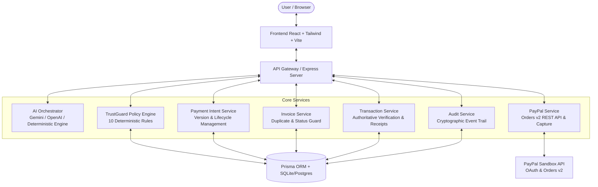
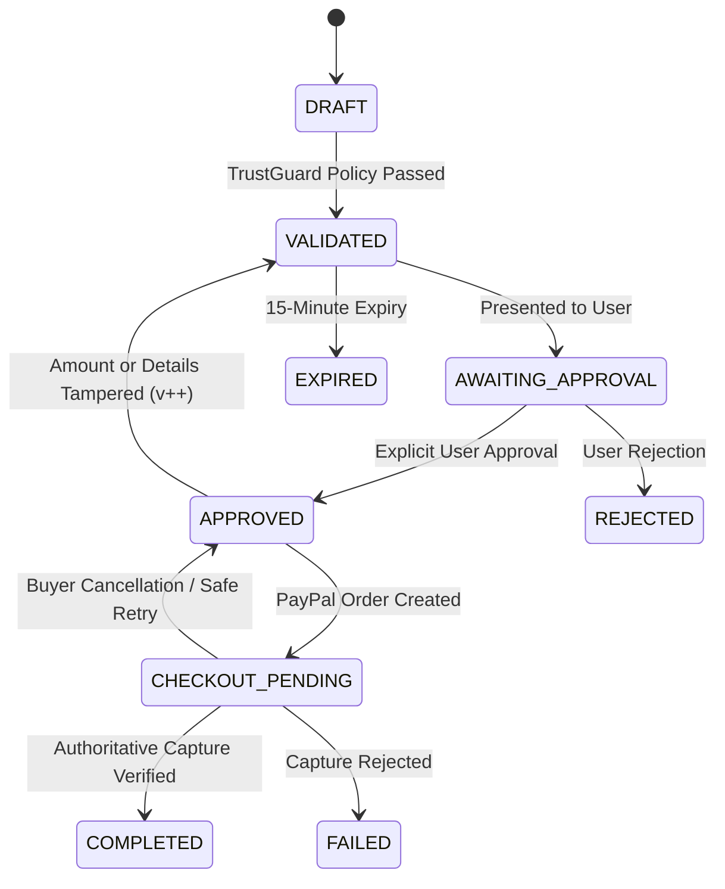

# PayPilot AI — Technical Architecture & Specifications
## PayPal AI Hackathon 2026

### 1. Architectural Overview

PayPilot AI is built as a **modular monolith** with clean separation between frontend presentation, AI orchestration, policy evaluation, database transactions, and PayPal payment execution.

---

### 2. TrustGuard Policy Engine — 10 Deterministic Rules

Never delegate financial security to a generative language model. PayPilot AI implements **TrustGuard**, a deterministic backend policy validator that evaluates 10 strict security controls before any payment intent can be approved or submitted to PayPal:

1. **`USER_AUTHORIZATION`**: Object-level access control verifying the caller owns the invoice and payment intent.
2. **`VALID_AMOUNT`**: Enforces strictly positive values (`amount > 0`), maximum 2 decimal places, and single-transaction limit of `$10,000 USD`.
3. **`SUPPORTED_CURRENCY`**: Enforces ISO currency whitelist: `USD`, `EUR`, `GBP`, `CAD`, `AUD`.
4. **`INTENT_EXPIRATION`**: 15-minute sliding safety window. Expired intents are marked `EXPIRED` and blocked from checkout.
5. **`INVOICE_NOT_PAID`**: Validates that the underlying invoice is not marked `PAID`. Blocks duplicate payments immediately.
6. **`INVOICE_NOT_CANCELLED`**: Rejects payments for cancelled or voided invoices.
7. **`INVOICE_AMOUNT_MATCH`**: Authoritative comparison between intent amount and invoice total; blocks unauthorized price discrepancies.
8. **`DUPLICATE_PAYMENT_DETECTION`**: Checks for completed transactions matching the same vendor, amount, and billing period in the past 24 hours.
9. **`EXPLICIT_APPROVAL_EXISTS`**: Requires a server-side `Approval` entity created by explicit user consent.
10. **`APPROVAL_VERSION_INTEGRITY`**: Binds user approval to the exact `intentVersion`. If an amount, vendor, or currency is modified after approval, the version increments (`v1 -> v2`) and the previous approval is instantly invalidated.

---

### 3. Payment State Machine

---

### 4. Authoritative PayPal Proof of Payment

1. **Server-Side Capture**: Payments are captured strictly server-side through `POST /v2/checkout/orders/{id}/capture` via authorized OAuth 2.0 access token.
2. **Authoritative Amount & Currency Match**: The server compares the captured amount and currency against the database intent. Any discrepancy throws an immediate validation exception.
3. **Idempotent Storage**: Orders and capture IDs have unique database constraints preventing duplicate processing.
4. **Authoritative Receipts**: Receipts render authoritative capture IDs, PayPal Order IDs, and timestamps directly from the authoritative PayPal response.

