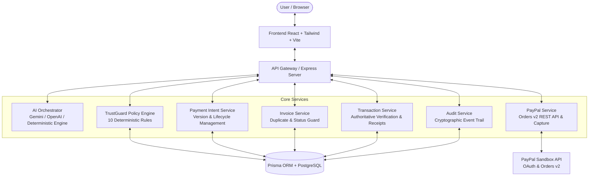
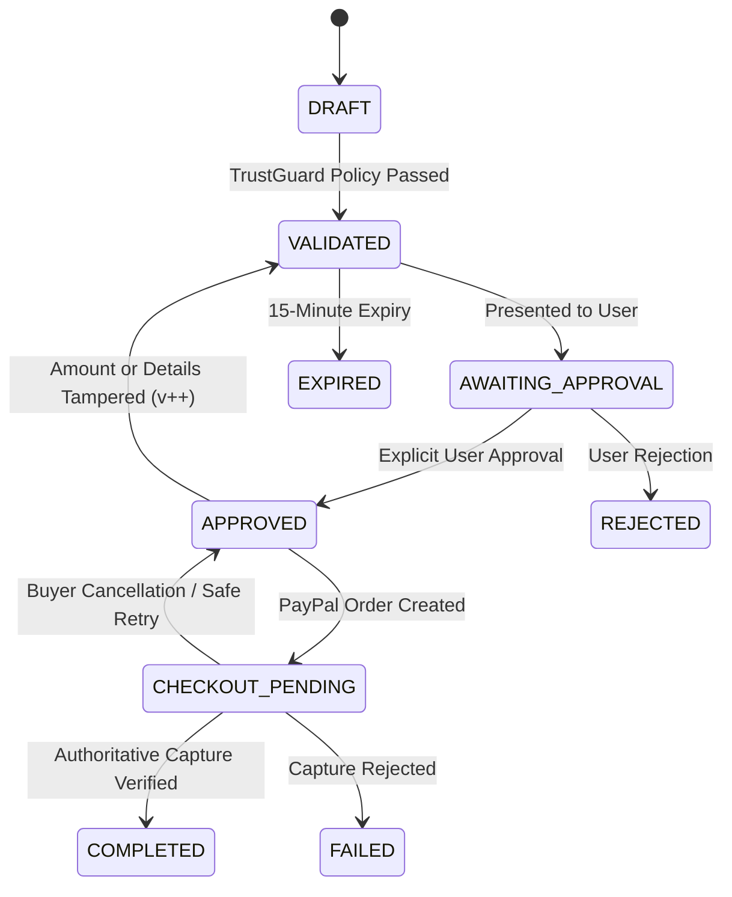

# PayPilot AI — Technical Architecture & Specifications
## PayPal AI Hackathon 2026

### 1. Architectural Overview

PayPilot AI is built as a **modular monolith** with clean separation between frontend presentation, AI orchestration, policy evaluation, database transactions, and PayPal payment execution.

---

### 2. TrustGuard Policy Engine — 10 Deterministic Rules

Never delegate financial security to a generative language model. PayPilot AI implements **TrustGuard**, a deterministic backend policy validator that evaluates 10 strict security controls before any payment intent can be approved or submitted to PayPal:

1. **`USER_AUTHORIZATION`**: Object-level access control verifying the caller owns the invoice and payment intent.
2. **`VALID_AMOUNT`**: Enforces strictly positive values (`amount > 0`), maximum 2 decimal places, and single-transaction limit of `$10,000 USD`.
3. **`SUPPORTED_CURRENCY`**: Enforces ISO currency whitelist: `USD`, `EUR`, `GBP`, `CAD`, `AUD`.
4. **`INTENT_EXPIRATION`**: 15-minute sliding safety window. Expired intents are marked `EXPIRED` and blocked from checkout.
5. **`INVOICE_NOT_PAID`**: Validates that the underlying invoice is not marked `PAID`. Blocks duplicate payments immediately.
6. **`INVOICE_NOT_CANCELLED`**: Rejects payments for cancelled or voided invoices.
7. **`INVOICE_AMOUNT_MATCH`**: Authoritative comparison between intent amount and invoice total; blocks unauthorized price discrepancies.
8. **`DUPLICATE_PAYMENT_DETECTION`**: Checks for completed transactions matching the same vendor, amount, and billing period in the past 24 hours.
9. **`EXPLICIT_APPROVAL_EXISTS`**: Requires a server-side `Approval` entity created by explicit user consent.
10. **`APPROVAL_VERSION_INTEGRITY`**: Binds user approval to the exact `intentVersion`. If an amount, vendor, or currency is modified after approval, the version increments (`v1 -> v2`) and the previous approval is instantly invalidated.

---

### 3. Payment State Machine

---

### 4. Authoritative PayPal Proof of Payment

1. **Server-Side Capture**: Payments are captured strictly server-side through `POST /v2/checkout/orders/{id}/capture` via authorized OAuth 2.0 access token.
2. **Authoritative Amount & Currency Match**: The server compares the captured amount and currency against the database intent. Any discrepancy throws an immediate validation exception.
3. **Idempotent Storage**: Orders and capture IDs have unique database constraints preventing duplicate processing.
4. **Authoritative Receipts**: Receipts render authoritative capture IDs, PayPal Order IDs, and timestamps directly from the authoritative PayPal response.

## Money, Auth and Failure Handling (current design)

**Money.** Every amount is an integer number of minor units (`amountMinor`, cents). Decimal input is parsed with string operations (`toMinor`), values with more than two decimals are rejected rather than rounded, and PayPal `value` strings are produced with integer formatting (`formatMinor`). The `amount` field in API responses is a read-only display value derived from `amountMinor`; no server code compares or sums it.

**Authentication.** Users register with a scrypt-hashed password and receive an 8-hour HS256 JWT sent in the `Authorization` header. Because no cookies are used, browsers never attach credentials automatically, so classic CSRF does not apply; CORS is restricted to `CLIENT_URL`. A one-click demo identity exists for judges and can be disabled. Every service call is scoped by `userId` (object-level authorization), and creating an intent against an invoice the caller does not own is refused.

**Payment outcome handling.** The server creates the PayPal order and records its id on the intent. Capture is accepted only for that order, and only after the server re-reads the order from PayPal and checks the intent id (`custom_id`), amount and currency. A timeout, a 5xx or a PENDING capture is *not* treated as failure: the intent moves to `PENDING_RECONCILIATION`, blind retries are refused, and `POST /api/payments/:intentId/reconcile` asks PayPal what actually happened (recording the verified capture if it exists, or reopening checkout if it does not). Webhooks are verified with PayPal's signature API and, even when valid, only recorded if they match the bound order, amount and currency.

## AI Agent (current design)

`services/agent/` contains three parts. `llm.ts` defines a provider-agnostic `LLMClient` with Gemini and OpenAI adapters (and a scripted implementation in tests). `tools.ts` defines eight server-side tools, each with a Zod argument schema and every query scoped by `userId`. `agent.service.ts` runs the loop: call the model, validate and execute requested tools, return results, repeat up to six steps, then pass the final text through the claim guard. The model has no tool that approves, captures or pays; `request_payment_approval` only surfaces the approval card. Invoice amounts, currency and recipient are read from the database, never from model arguments. When no key is configured or the provider errors, the rule-based engine in `ai.service.ts` answers instead and the fallback is audited.

Supporting services: `InsightsService` (deterministic analytics over verified captures, integer cents), `InvoiceExtractionService` (pasted text to an unsaved draft, LLM or heuristic, output re-validated), and the expiry sweeper in `PaymentIntentService`.
